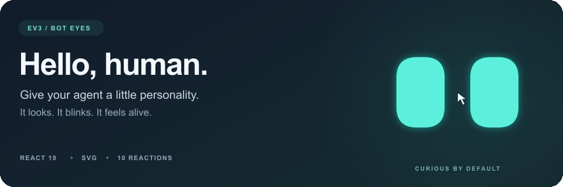
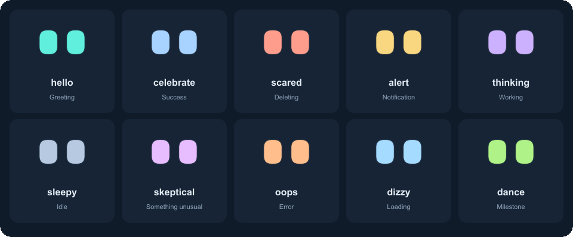
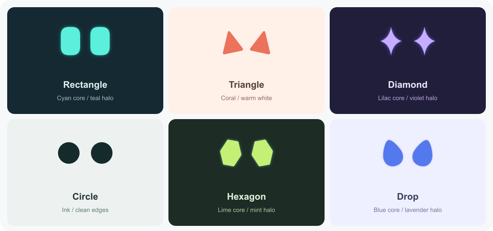

<div align="center">

# EV3 Bot Eyes

**Give your agent a little personality.**

Expressive SVG eyes that look, blink, and react. Built for React.

[Get started](#install) · [Meet the reactions](#ten-reactions-plenty-of-character) · [Find your look](#six-shapes-your-signature)

React 19 · TypeScript · SVG · [MIT](./LICENSE)

</div>



Turn an avatar, assistant, or loading state into a tiny character. A curious
glance while the cursor moves. A nervous flinch before a delete. A happy dance
when the work is done. You choose the moments; the eyes bring the expression.

- **Feels alive.** Smooth cursor tracking, a shared invisible head, and natural blinks.
- **Looks like your product.** Six shapes, mirrored rotation, and separate eye and halo colors.
- **Fits your stack.** One React component, typed controls, SSR support, and no stylesheet to wire up.

[Still banner preview](./docs/assets/hero.png) · [Run the playground locally](#develop)

## Install

```sh
npm install @umunnu/ev3-bot-eyes
```

Requires React 19. For a checkout or a prerelease archive, run `npm pack` in this
repository and install the resulting `.tgz` path in your app instead.

## Quick start

```tsx
import { useRef } from 'react';
import { CuriousEyes, type CuriousEyesHandle } from '@umunnu/ev3-bot-eyes';

export function AgentAvatar() {
  const eyes = useRef<CuriousEyesHandle>(null);
  return (
    <div>
      <CuriousEyes
        ref={eyes}
        size={96}
        appearance={{
          shape: 'rectangle', width: 15, height: 22, rounding: 85,
          color: '#29e8ed', edgeBlur: 0.6, blurColor: '#08a6bd',
        }}
        onAnimationEnd={(animation, reason) => {
          if (reason === 'completed') console.log(`${animation} finished`);
        }}
      />
      <button onClick={() => eyes.current?.play('dance')}>Celebrate</button>
    </div>
  );
}
```

To greet on mount, call `eyes.current?.play('hello')` in a parent `useEffect`.
Each reaction runs once. The host app chooses which actions trigger reactions
and owns any saved appearance preferences.

## Ten reactions. Plenty of character.

Say hello. Think it over. Celebrate the small wins. Ten built-in reactions turn
ordinary app events into moments with a little more feeling.



Every reaction is a one-shot, triggered with `eyes.current?.play('thinking')`
or any of the other nine IDs. Your app decides when to play, replace, repeat,
or stop one. The renderer respects reduced motion and visibility.

[Still reaction gallery](./docs/assets/reactions.png)

## Six shapes. Your signature.

Soft rectangles, pointed triangles, inward-curving diamonds, circles, hexagons,
or drops. Change the proportions, soften the corners, tilt each eye in opposite
directions, and give the glow a color of its own.



Crisp ink on a light surface or a bright core with a soft halo on dark. The blur
grows **outside** the eye, so its solid shape keeps the size you chose. Every
look above uses the same component; these are starting points for your design.

## Component API

| Prop | Default | Meaning |
| --- | --- | --- |
| `appearance` | default appearance | Partial settings; omitted, undefined and non-finite values use defaults. |
| `size` | `52` | SVG width/height; number or SVG length string. |
| `className`, `style` | unset | Host styling. CSS dimensions can override `size`. |
| `animated` | `true` | Ambient cursor tracking and blinking. Changing it preserves active reactions. A still instance can explicitly play a reaction. |
| `ref` | unset | React 19 ref exposing `play(id): boolean` and `stop(): void`. |
| `onAnimationEnd` | unset | `(animation, reason) => void`; once for each accepted playback. |

`play` returns false for an unknown ID, hidden/offscreen eyes, reduced motion, or
an environment without `requestAnimationFrame`. It replaces a running reaction. `stop` ends the current reaction and restores
ambient tracking if enabled. Repeated `stop` calls do not emit extra callbacks.

Callback reasons:

- `completed`: the reaction reached its duration.
- `stopped`: the host called `stop()`.
- `replaced`: another `play()` replaced it. This callback runs inside `play()`.
- `cancelled`: visibility, reduced motion, or unmount ended it.

When repeating a thinking reaction, repeat only for `reason === 'completed'`
and only while work remains pending. Handle replacement/cancellation without
restarting the old reaction. One-argument callbacks remain compatible.

Offscreen detection waits for the browser's first IntersectionObserver report,
which arrives shortly after mount. Until then an instance counts as visible, so
a mount-time `play()` on eyes that start offscreen returns true and then ends
with `cancelled`.

In development, React StrictMode simulates an unmount and remount right after
the first mount. A reaction started from a mount effect therefore reports
`cancelled` once, then plays again when the effect reruns. Production builds
report only the real run.

The SVG is decorative (`aria-hidden`, unfocusable, no pointer interception).
Give its surrounding button/avatar an accessible name when appropriate. Its
inline styles allow the halo to overflow; a parent with `overflow: hidden`
can still clip it.

### Appearance

| Field | Default | Accepted values |
| --- | --- | --- |
| `shape` | `rectangle` | `rectangle`, `triangle`, `diamond`, `circle`, `hexagon`, `drop`. |
| `width`, `height` | `13`, `18` | Solid eye dimensions, 0.1–64 SVG units. |
| `gap` | `7` | Clear space between unrotated eyes, 0–64 SVG units. |
| `rounding` | `85` | 0–100. Diamond sides curve inward; circle is already round. |
| `rotation` | `0` | −180° to 180°, clockwise on the left, reversed on the right. |
| `color` | `currentColor` | CSS color, including custom properties. Inherits surrounding text color by default. |
| `edgeBlur` | `0` | 0–1; halo grows outside the solid eye size. |
| `blurColor` | `null` | CSS color; null follows the eye color. |

Finite numeric settings are clamped to these ranges. Unknown shapes and empty
colors use defaults. CSS color strings are passed through for the browser to
resolve. The same normalization applies to the component and appearance-based
geometry helpers. `normalizeCuriousEyesAppearance`, `defaultCuriousEyesAppearance`
and the literal-color `curiousEyesPalette` are exported conveniences.

### Reactions and motion

`hello`, `celebrate`, `scared`, `alert`, `thinking`, `sleepy`, `skeptical`, `oops`,
`dizzy`, and `dance`. `curiousEyesAnimations` provides names, descriptions,
suggested scenarios and durations.

Pointer movement is smoothed; touch does not steer the eyes. Losing focus returns
them to center. Hidden/offscreen instances and reduced motion stop playback.
Unmount removes listeners and cancels timers/frames. Instances share a pointer
listener and read bounds once per animation frame, avoiding layout reads on every
pointer event. The renderer does not rerender React on animation frames.

## SSR and framework use

Server output contains both eyes in their neutral projected positions and works
as a still mark without JavaScript. Hydration enables motion. The component entry
retains `"use client"`; in Next.js, place refs and event handlers in a client
component. Pure geometry/animation entry points do not need React or browser APIs.

Missing `matchMedia` defaults to no reduced-motion preference; missing
`IntersectionObserver` defaults to in-view. This also supports component tests in
jsdom without requiring either API to be mocked. jsdom provides
`requestAnimationFrame` only with `pretendToBeVisual: true`; without it the eyes
render still and `play` returns false.

## Advanced geometry and animation API

```ts
import { eyeShapePath, eyeViewBox } from '@umunnu/ev3-bot-eyes/geometry';
import { sampleEyesAnimation, animationDuration } from '@umunnu/ev3-bot-eyes/animations';
```

All documented utilities are also exported from the main entry point. Geometry
exports include `eyeBlurRadius`, `eyeTransform` (SVG matrix string), `eyeViewBox`
(SVG viewBox string) and `fitEyeExpression` (a scale factor at most 1). These are
supported advanced APIs. Fitting considers the solid shapes only; blur expands
its own filter region. Animation exports include `neutralEyeExpression` and
`isCuriousEyesAnimation`. Validate untrusted IDs with the latter; the pure
sampler and duration helper throw a descriptive `RangeError` for unknown IDs.

Declarations support Node16, NodeNext, bundler and legacy Node10 resolution,
including the geometry/animation subpaths.

## Develop

Use Node 22.13+ or 24+ and npm for repository tooling. This is a development
requirement; the browser package imposes no Node engine constraint on consumers.

```sh
npm ci
npm test                  # geometry, SSR and deterministic jsdom lifecycle tests
npx playwright install chromium
npm run test:browser      # Chromium lifecycle, hydration and motion checks
npm run typecheck
npm run build:demo
npm run lint:package      # publint and Are the Types Wrong
npm pack
npm run dev               # playground: http://127.0.0.1:5174
```

Rebuild with `npm run build` after editing source while the playground is running.
CI runs the checks on Node 22 and 24. Both output formats use modern Node16
module resolution during compilation. See [CHANGELOG.md](./CHANGELOG.md) for
version changes and [LICENSE](./LICENSE) for the MIT license.
